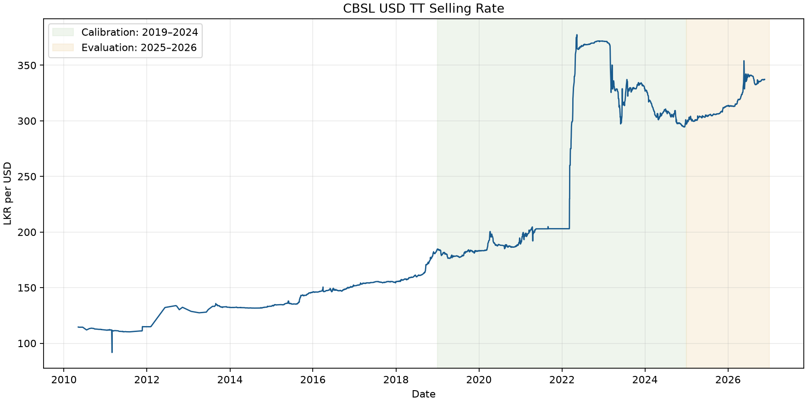

# USD/LKR Importer Risk Simulator

A Python project that prepares USD/LKR quotes and simulates hypothetical importer payment risk with GBM and a bounded two-state Markov volatility extension.

**Current scope:** the repository contains data preparation, a 2019–2024 calendar-time GBM fit, a bounded quote-step Markov volatility layer, importer cost/VaR/ES calculations, reproducible seeded runs and automated checks. The historical-window and time-convention comparison plan is in [THEORY.md](THEORY.md). The complete notebook experiments and interactive demo remain to be built. The docs/ page is a status page.

[Project page source](docs/index.html) (GitHub Pages deployment is not verified) · 

## The problem

Sri Lankan importers with USD invoices need to plan for the LKR cost of future payments. The cost rises when the LKR-per-USD rate rises. This simulator explores that uncertainty under stated models, data and time assumptions.

The current code fits historical GBM and Markov parameters, draws exchange-rate scenarios and converts them to hypothetical importer payment costs and upper-tail risk measures. These estimates are conditional model outputs, not validated forecasts.

## Quick start

Use Python 3.10 or later.

    python -m venv .venv

Activate the environment, then install the project requirements.

    # Windows PowerShell
    .venv\Scripts\Activate.ps1
    python -m pip install -r requirements.txt

    # macOS / Linux
    source .venv/bin/activate
    python -m pip install -r requirements.txt

Run the data-preparation pipeline from the repository root:

    python -m src.prepare_data

The pipeline reads data/raw/CBSL_USD_TT_Selling.csv, writes outputs to data/processed/, and refreshes figures/usd_lkr_selling_rate.png. The raw input is checked for changes and is not rewritten.

Fit the baseline GBM from the prepared 2019–2024 returns:

    python -m src.calibration

This writes `data/processed/gbm_calibration_2019_2024.json` with annual coefficients, window/count information and input hashes. `src/gbm.py` provides exact seeded terminal and path rate draws; see [USER_GUIDE.md](USER_GUIDE.md).

Fit the bounded two-state extension from the same training returns:

    python -m src.markov

This writes `data/processed/markov_calibration_2019_2024.json` with the training-only state rule, transition counts/probabilities and conditional residual volatilities. A transition is one assumed published-quote increment, not one calendar day. See [USER_GUIDE.md](USER_GUIDE.md) for the explicit future quotation schedule used by the path function.

Run the documented hypothetical invoice scenario:

    python -m src.run_risk

This writes `data/processed/importer_risk_baseline_2019_2024.json`. It uses USD 100,000 due 90 calendar days after 2024-12-31, a fixed LKR budget 5% above the reference cost, and eight independent seeds (42–49) with 10,000 paths per seed and model.

Run the automated checks:

    python -m pytest -q

Open the prepared-data notebook locally:

The notebook interface is optional and is not listed in requirements.txt. If needed, install it with python -m pip install notebook.

    jupyter notebook notebook/usd-lkr-importer-risk-simulator.ipynb

In Colab, the repository must be accessible to Colab. Install dependencies and run the notebook after cloning the repository.

## Using the project

There is no web-demo control panel yet. The command-line workflow prepares data, fits both models and runs the importer payment-risk scenario. The existing notebook still inspects prepared data; the final model notebook is later work. Full setup details are in [USER_GUIDE.md](USER_GUIDE.md).

## Model and mathematics

For consecutive observed quote rows, the prepared log return is

\[
r_i = \ln\!\left(\frac{S_i}{S_{i-1}}\right),
\]

where \(S_i\) is the USD TT selling rate in LKR per USD. Missing calendar dates are not interpolated. The primary GBM fit uses each actual gap divided by 365 years; a future `H`-calendar-day rate horizon uses `H/365` years. The fitted annual log drift is 0.079197, volatility is 0.120814 per square-root year, and level drift is 0.086495 per year. These are historical model estimates, not reliable future-rate predictions. The 252-session alternative remains a later sensitivity comparison; see [THEORY.md](THEORY.md).

The bounded Markov layer labels the smallest 70% of training-only absolute gap-standardized GBM residuals “stable” and the rest “volatile.” The fitted quote-step transition matrix is `[[0.814851, 0.185149], [0.431871, 0.568129]]` in stable/volatile order. A future quote step samples the next state first, then uses that state's volatility over the actual assumed calendar gap. The labels are a heuristic, not independently observed economic regimes.

## Verification

The full local Windows suite ran on 2026-11-23: **59 passed in 2.38s** (`.venv\Scripts\python.exe -m pytest -q`). It checks data preparation, model fitting/transitions, hand-calculated importer costs, signed upper-tail VaR/ES, invoice scaling, seeded replay and the saved baseline report. A Linux/Colab test run has not yet been performed; passing tests do not establish source authenticity or predictive adequacy.

## Concepts applied

The current work uses time-series cleaning, chronological training/holdout separation, variable-gap Gaussian fitting, seeded GBM/DTMC simulation, Monte Carlo integration of payment costs, upper-tail VaR/ES and numerical verification.

## Results

The supplied snapshot has 3,381 usable USD quotes from 2010-05-07 through 2026-11-19. The initial calibration window contains 1,445 quotes and 1,444 in-window returns. The available evaluation window contains 457 quotes and 457 returns; its first return is anchored to the preceding observed quote. The 2026 window is partial in this snapshot.

The baseline fit uses 2,191 elapsed days (6.002740 model years) and ends at the 2024-12-31 selling rate of 297.0162 LKR/USD. The hypothetical USD 100,000 invoice has a reference cost of LKR 29,701,620 and a due date of 2025-03-31. The budget is LKR 31,186,701. Each model used 80,000 simulated paths across the stated seeds.

| Model | Mean payment cost (LKR) | 95% VaR of extra cost (LKR) | 95% ES of extra cost (LKR) | Budget exceedance |
|---|---:|---:|---:|---:|
| GBM | 30,339,206 | 3,731,194 | 4,582,741 | 31.29% |
| Markov | 30,345,423 | 3,679,169 | 4,609,172 | 30.51% |

These are reproducible conditional simulation results, not realized payments or predictions. The report contains mean-cost Monte Carlo intervals, per-seed results and between-run VaR/ES variation.

The Markov training fit has 1,011 stable and 433 volatile returns. Its state residual RMS values are 0.010525 and 0.220040 per square-root year, respectively. The volatile estimate is strongly affected by the retained 2022 movements; the transition matrix is not a crisis predictor.

## Limitations and future work

- The downloader identified the [CBSL daily buy-and-sell page](https://www.cbsl.gov.lk/en/rates-and-indicators/exchange-rates/daily-buy-and-sell-exchange-rates) as the source site, but the exact export request, download date and reuse terms are not recorded. Confirm redistribution rights before publishing the data.
- The series is a daily TT selling-rate series, not an intraday executable quote or continuous market mid-rate.
- Quote intervals are irregular. The fitted calendar-time model assumes variance accrues over weekends and holidays in proportion to elapsed days; a separate 252-session sensitivity comparison is still needed. Neither convention is established as empirically correct by code tests.
- The evaluation period ends at the source snapshot's last date and is therefore incomplete for 2026.
- The baseline fit retains 2022. The 2019–2021, 2022–2024 and separately labelled 2022-excluded model comparisons remain to be run; the unusually large 2022 movements make a constant-coefficient drift especially uncertain.
- The Markov states are thresholded realized returns, not observed hidden regimes. Its weekday future-quotation helper ignores holidays and settlement timing; any model comparison must declare the same invoice due date and quotation schedule.
- Monte Carlo intervals measure sampling precision with fitted parameters held fixed. They exclude calibration-window and structural model uncertainty; trading fees and importer-specific bank spreads are also excluded.

## Key references

1. Central Bank of Sri Lanka, “Daily Buy and Sell Exchange Rates.” [Online]. Available: [CBSL daily rates page](https://www.cbsl.gov.lk/en/rates-and-indicators/exchange-rates/daily-buy-and-sell-exchange-rates). The downloader reports using this page; the local CSV's exact export and download date are not recorded. See the [CBSL rate definition](https://www.cbsl.gov.lk/en/node/146).
2. Board of Governors of the Federal Reserve System (US), “Sri Lankan Rupees to U.S. Dollar Spot Exchange Rate [DEXSLUS],” retrieved from FRED, Federal Reserve Bank of St. Louis. [Online]. Available: [FRED series page](https://fred.stlouisfed.org/series/DEXSLUS). The FRED files in this repository are reference only.

See [REFERENCES.md](REFERENCES.md) for source notes.

## AI assistance

AI tools assisted with planning, documentation, code drafting and model tests. Run the checks in your own environment before relying on outputs.

## Licence and credits

The MIT licence in [LICENSE](LICENSE) applies to the project's code and documentation only. The data has separate, unresolved reuse terms; see [data/README.md](data/README.md) before sharing it.
